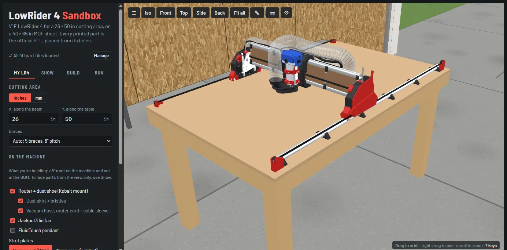
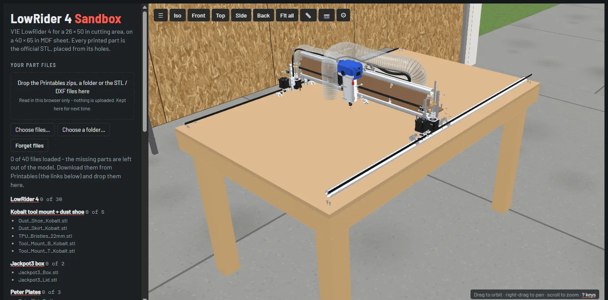
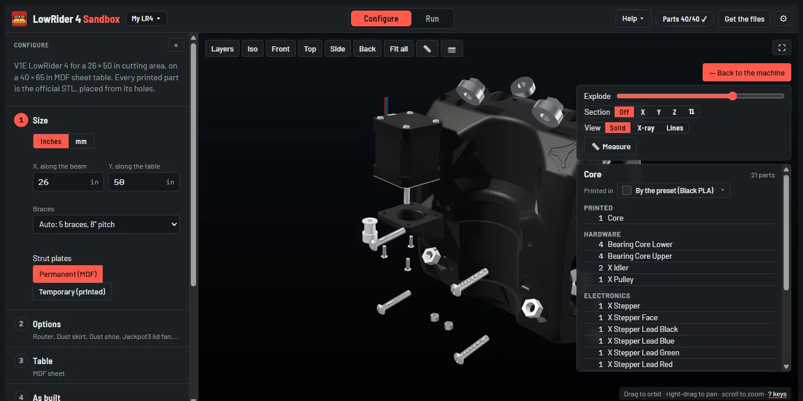
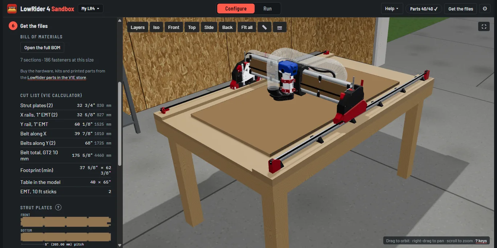
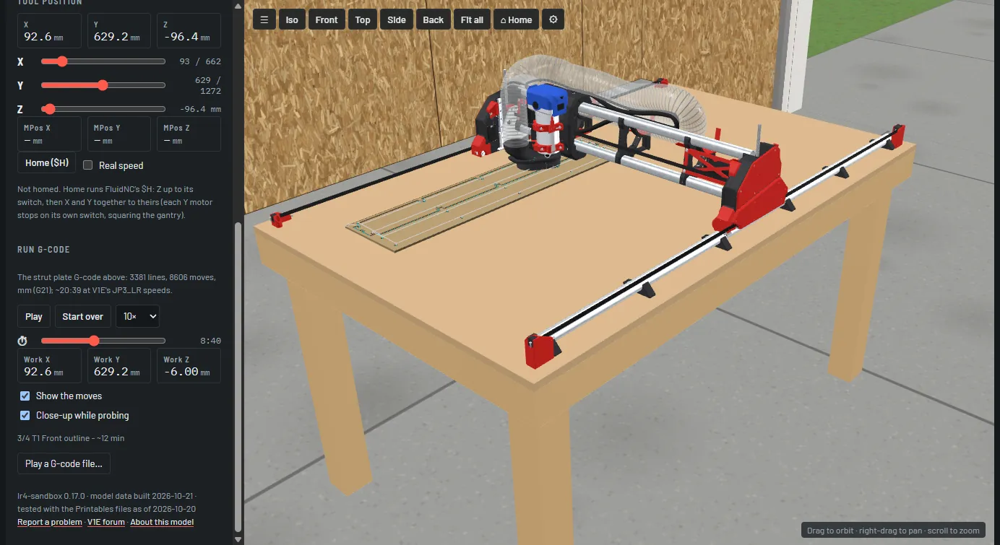
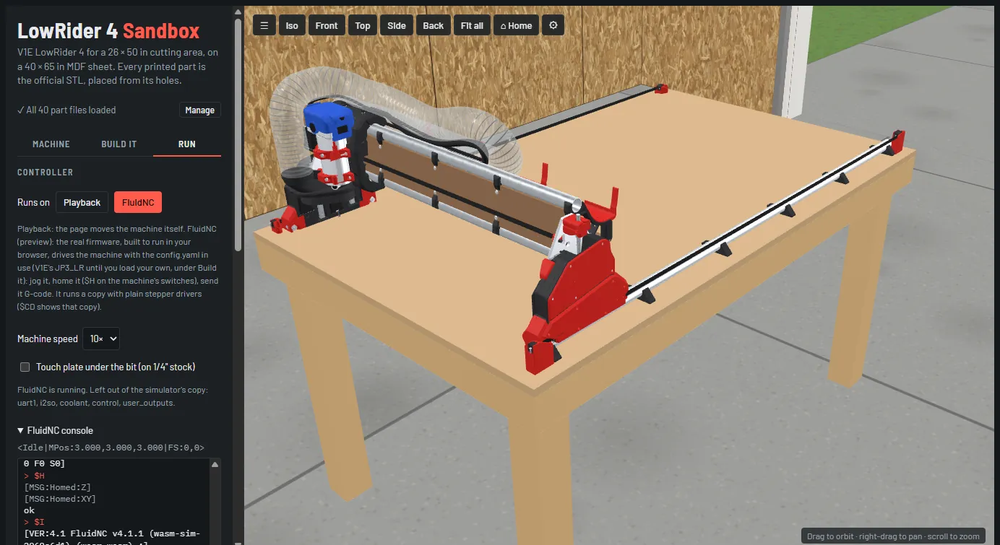
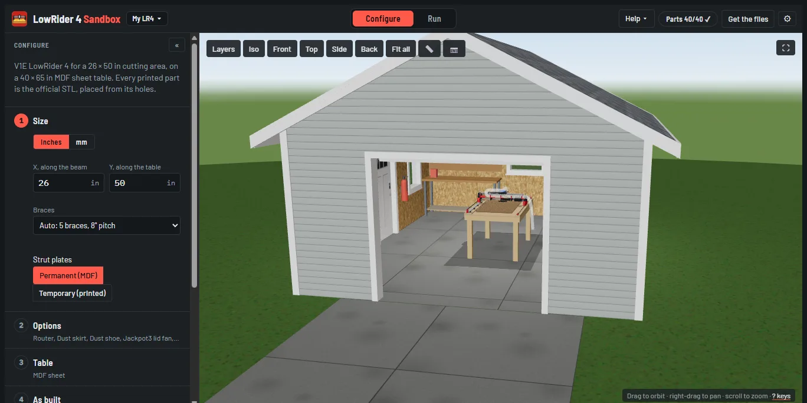

# LowRider 4 Sandbox

A full 3D model of the [V1 Engineering LowRider 4](https://docs.v1e.com/lowrider/) CNC that you can size, build and
run in your browser. Enter your cutting area and **LowRider 4 Sandbox** draws the whole machine from the real printed
part files, with the cut list, strut plates, bill of materials and a FluidNC `config.yaml` for that size. Then run
it: play G-code on it and watch the stock get carved, or drive it with the real FluidNC firmware running in the
page (home, jog, probe, console). Behind the page is a FreeCAD model that places every part by its measured mating
features and checks every fastener.



> [!WARNING]
> Still under development. There's no guarantee that the model, measurements, cut list, BOM, G-code or config.yaml
> are accurate: check them against V1 Engineering's docs before you cut, print or buy anything.

## What's here

| | |
|---|---|
| **LowRider 4 Sandbox** (`web/index.html`) | The page. **My LR4:** enter a cutting area and it builds the machine in 3D (every printed part, rail, belt, bolt, the strut plates and the vacuum hose); choose what's on it (router + shoe, hose, lid fan, pendant, Peter Plates, strut plates). **Show:** a tree of every part by assembly and kind, with presets, to hide parts from the view, and an inspect view for one assembly at a time. **Build:** the cut list (V1E's calculator), the strut plate outlines, DXF / SVG / G-code downloads, the full BOM and a `config.yaml` for your size. **Run:** play G-code on the machine, or drive it with FluidNC in the browser. Plus machine sounds, a workshop round it, VR, share links and scripted demo videos. |
| **FreeCAD model** (`freecad/`) | Scripts that assemble the LowRider 4 in [FreeCAD](https://www.freecad.org/) from the official STLs. Every part is placed by its measured mating features (hole patterns, pockets), and every fastener is checked for seat, engagement and collisions. Outputs: an FCStd assembly, a BOM, strut plate DXF/SVG and G-code. |
| **Pipeline** (`pipeline/`) | Builds the model at many sizes and fits how each part moves with the size. That is how the page can draw any size without FreeCAD. |
| **FluidNC in the browser** (`web/fluidnc/`) | FluidNC's wasm port, built from a fork's `wasm-sim` branch with simulated limit switches, a touch plate probe and a time scale. |

## The part files

The printed parts are **not** in this repo. They are V1 Engineering's files, all on V1E's Printables pages. You
download them yourself (free), and the page or the FreeCAD scripts place your copies:

| Download | Folder in `parts/` (FreeCAD only) |
|---|---|
| [LowRider 4](https://www.printables.com/model/1034840) (V1 Engineering), including the XZ plate DXFs | `lr4/` |
| [Kobalt tool mount + dust shoe](https://www.printables.com/model/1034828) (V1 Engineering) | `kobalt/` |
| [Jackpot3 box](https://www.printables.com/model/1434650) (V1 Engineering) | `jackpot3/` |
| [Peter Plates](https://www.printables.com/model/1044487) (V1 Engineering) | `peter/` |

On each Printables page, use **Download** to get all of the model's files as one zip. Nothing else is needed: the
page and the scripts bring their own hardware models (steppers, bearings, rails, bolts, router, hose).

### Adding them to the page

1. Open the page. Until it has the files, it draws only the hardware, and the **Your part files** panel at the top
   of the side panel lists what's missing, with a Printables link for each download.
2. Drop the four zips anywhere on the page. You can also drop a folder or loose STL / DXF files, or use
   **Choose files…** / **Choose a folder…** in the panel.
3. The panel counts them in ("✓ All 40 part files loaded") and the printed parts appear. **Manage** opens the panel
   again later; **Forget files** clears them.



The files are read in your browser and kept there (IndexedDB) for next time; nothing is uploaded. Each file is
recognised by its SHA-256, so renamed files are fine. A file that differs from the version the placements were
solved for is still used, with a warning in the panel. `parts/manifest.json` lists every file with the SHA-256 it
was tested with.

### Adding them for the FreeCAD scripts

Unzip each download into its folder under `parts/` (the table above), for example `parts/lr4/YZ_Plate_Min_V1.stl`.
`python tools/check_parts.py` lists what's missing or differs. `parts/` is git-ignored, and a pre-commit check
(`tools/check_no_parts.py`) stops part files from being committed.

## Using the page

### My LR4, Show and Build

**My LR4:** enter the cutting area (inches or mm) and the page rebuilds the machine: brace count, rails, belts,
table, hose routing. Options take parts off the machine and the BOM (router + dust shoe, skirt, hose, lid fan,
pendant), and pick the strut plates (MDF or the printed temporary ones) and the Peter Plates style (Open, Closed,
Honeycomb or None). Also here: the table height and the print colours.

**Show** only hides parts from the view, never from the BOM: a tree of assembly > printed / cut / hardware /
electronics > part (a bolt is listed under both assemblies it joins), with presets (All, No hardware, Printed parts
only, Frame only). **Scene** sets the detail (Full, or Lite for slower devices), the lighting (Realistic: the
workshop's own lights, soft shadows on Full detail and filmic colour; or Simple: even light, lightest on the GPU) and
the background (the workshop, the same shop empty, or plain).

**Inspect** (⤢ on a Show row, or double-click a part) shows one assembly or part alone with the bolts and bearings
that hold it, and its parts list with screw and nut counts. Its tools: an exploded view (along the bolt lines), a
section cut (X, Y or Z, either side), X-ray (the printed parts see-through, the hardware solid), Lines (edges only)
and a measuring tool that snaps to corners and hole centres. Esc or **Back to the machine** returns.



**Build** has the cut list from V1E's LowRider 4 calculator, the strut plates (DXF / SVG, or G-code to cut them on
the machine itself), the full BOM with hardware counts for your size, and V1E's JP3_LR `config.yaml` with
`max_travel_mm` set for your size (or your own config.yaml, adjusted the same way).

Building numbers (the cutting area, table, braces pitch, cut list, strut plate drawing) follow the inches / mm
switch. Running numbers (tool position, MPos, work position, jogging, the G-code settings) are always mm with 3
decimals, as FluidNC reports them.



### Run: Basic

**Run** > **Runs on Basic** plays G-code on the machine: the strut plate job (V1E's build order: the machine runs
on its printed temporary struts and cuts its own MDF strut plates; **Use the temporary struts**), or any G-code file
from the page's **SD card** (**Add G-code files…**, or drop them on it; ▶ plays one). The bit follows the moves at
FluidNC-like speeds, the stock is carved as it goes (with the file's own bits, from
[cnc-gcode-tools](https://github.com/jeyeager65/cnc-gcode-tools) `(Stock: ...)` / `(ToolDef ...)` comments, or ones
you describe under **Stock and bits**), M0 pauses pop up their message, G38.2 probes stop on the touch plate, tool
changes swap the bit, and **Home ($H)** plays FluidNC's homing. Speeds 1x to 100x; scrub with the timeline;
**Space** plays / pauses. With **FluidTouch pendant** ticked (off by default), the pendant on the table works
here too: it talks to a small stand-in for
FluidNC (labelled as such) that homes, jogs, holds / resumes, lists the SD card and plays a file from it; anything
else answers "not in Basic mode".



### Run: FluidNC

**Run** > **Runs on FluidNC** boots the real FluidNC firmware in the page, with your config.yaml (V1E's JP3_LR until
you load your own under Build). The browser build has no stepper drivers or real pins, so it runs a translated
copy: every motor becomes a plain stepper and the limit and probe pins move to known pins; rates, acceleration,
travel, homing and limits are kept as in your file. (`$CD` in the console shows that copy; the page's config.yaml
download is always your real file.)

- **Home ($H)** homes on the machine's switches: each switch trips when its motor reaches the stop, so each Y motor
  stops on its own switch and squares the gantry, as on the real machine.
- **The jog pad** jogs X / Y / Z by a step (0.1 to 100 mm) at a feed; ■ stops the jog.
- **Touch plate under the bit** puts the plate on the stock so G38.2 stops on it.
- **The console** takes any G-code or `$` command and shows FluidNC's replies.
- **Machine speed** runs it at 1x, 2x, 5x or 10x.
- MPos is greyed until it has homed: like the real controller, it doesn't know where the machine is until then.

G-code files on the page's SD card run through FluidNC too (`$SD/Run`), from the page or from the FluidTouch pendant.

**Web UIs:** put a web UI on FluidNC's SD card or Flash (WebUI 3, WebUI 2 or FigUI: their release `index.html.gz`,
as they are) and **Run > Controller > Web UIs > Open** shows it in a window of its own, served by the page's FluidNC
web server the way a board serves it: watch and drive the machine from there, upload files to its card. The Flash's
`index.html.gz` opens at `/`, `/sd/ui/<name>/index.html.gz` at `/ui/<name>/`, any other `x.html.gz` at
`/sd/x.html` (FluidNC's WebDAV, in 4.1.1 too). Keep the sandbox tab open: FluidNC runs there, and the window reaches
it through its own service worker (`web/device/`; same browser only). Several UIs open at once can get errors from
FluidNC, as on a board.



**Browser:** tested in desktop Chrome (and Edge for VR). FluidNC mode needs the page to be cross-origin isolated
(its threads need SharedArrayBuffer). `tools/serve.py` sends the headers; on GitHub Pages the page reloads itself
once on the first visit to turn it on (a service worker, `web/coi-serviceworker.js`). Private windows without
service workers can't run FluidNC mode; everything else works.

### Workshop

**Show** > **Scene** > **Background** > **Workshop** shows the machine in a workshop: by default the maintainer's
16 x 20 ft shop with an 8' 4" ceiling (benches, shelf, an open garage door, four 4 ft LED strips that light the
scene). **Empty shop** is the same building with only the garage door, the lights and the fire extinguisher. Zoom in
and the near walls open up;
zoom far out to see the closed building. Enter your own building's size (X, Y, ceiling, under Background) to see how
much room the machine takes: the page gives the gap to each wall and warns when a side is under 2 ft / 600 mm. The
room and the table legs are drawn by the page only.



### Sound

**⚙** (on the canvas) > **Sound** turns on machine sounds, synthesized live from what the machine is doing: the
steppers (TMC2209s in StealthChop, pitched by each axis' step rate), the Kobalt router at its dial speed with the
cutting load (it bogs down in a deep cut), the shop vac, the switch clicks when homing and the touch plate tap. The
same menu has the volume and, for fun, a "robot noises" voice.

### Around the view

- **Iso / Front / Top / Side / Back / Fit all** (keys **1**-**5**, **F**) set the camera; on a phone they fold into
  one **View** menu. ☰ (**H**) hides the side panel.
- **📏 Measure** (**M**): two clicks on the machine, snapping to corners and hole centres; Esc ends it.
- **📷** (**P**) saves the view as a PNG.
- **?** lists the keys. ⚙ also connects a 3Dconnexion SpaceMouse.
- **Copy a link to this build** (in the footer) puts the size, braces, plate choices, options, pendant, table, room,
  colours and units in the link, for example `#26x50&braces=6&hose=0&units=mm`; opening it sets them.
- **Reset settings** (footer) puts every setting back to the default; your part files and SD card stay.

### VR (optional)

With a PC VR headset on SteamVR / OpenXR (PS VR2, Index, Quest Link) and Chrome or Edge, the toolbar shows
**Enter VR** (https or 127.0.0.1 only); the desktop window then shows a small card instead of the side panel. Left
controller: the menu (tap its grip to hide it). Touch a part - or point at it and pull the trigger - for its name
and Hide part / Hide group. Trigger also presses menu buttons, grabs the red sphere to move the core and drags the
corner diamond to resize the table (snaps to 1/2 in, rebuilds when you let go). Hold a grip to drag the machine;
hold both to zoom and rotate. Thumbstick: left / right turns; at 1:1 push forward to aim a teleport and let go to
jump; on the tabletop forward / back zooms. Load part files on the desktop first.

## Running it locally

```sh
python tools/serve.py sandbox 48x96          # the page on 127.0.0.1:8767; optional size in inches
```

It serves the repo with the cross-origin isolation headers and opens the page with `?parts=/parts/`, so it loads
the files in your `parts/` folder (if you have one) without dropping them.

## Making videos from G-code

`tools/record_demo.js` records an MP4 of the page running a G-code file, with the machine sounds. The video is
scripted by `(Video ...)` comments in the file itself, in the style of cnc-gcode-tools' `(CNCSIM)` / `(Stock:)` /
`(ToolDef)` comments: FluidNC and the page ignore them, so one file is both the job and the video. It runs the page
in headless Chrome and steps its clock one frame at a time, so the video plays at true speed however long each frame
takes to render (1080p: about 6 minutes for a 2 minute video).

It needs a clone of this repo, the part files in `parts/` (see above), Node 22+, Chrome and ffmpeg on the PATH:

```sh
python tools/serve.py sandbox --no-open      # serve the page (with the headers FluidNC and the pendant need)
node tools/record_demo.js docs/examples/feature_demo.gcode exports/video/feature_demo.mp4
```

[`docs/examples/feature_demo.gcode`](docs/examples/feature_demo.gcode) is a worked example: a tour of the page
(Show presets, the core in Inspect: exploded, cut, X-ray, lines), then homing, a probe and a small sign cut with two
bits (a 1/8" flat for the letters and holes, a tool change, a 90° V-bit for the border), with captions, camera
shots and the FluidTouch pendant's screen in a corner. The comments:

| Comment | What it does |
|---|---|
| `(Video: SIZE=1920x1080 FPS=30 SOUND=on ...)` | Settings, before the first move: size, frame rate, volume, `VOICE=robot`, `DETAIL`, `SCENERY=shop\|empty\|plain`, `MACHINE=26x50` (cutting area, in), the machine's options as on My LR4 (`TABLE=34in ROOM=16x20x9ft BRACES= STRUTS= PETER= ROUTER= SKIRT= HOSE= FAN= MAIN= ACCENT=`), `PENDANT=on`, `MODE=fluidnc` (run it on the page's FluidNC), how long M0 pauses and messages show (`PAUSE`, `MESSAGETIME`), `PARK=on`, `HOLD` on the result. |
| `(Video Title: TIME=3 TEXT=Line one\|Line two)` | A full-screen title card. |
| `(Video Text: TIME=4 TEXT=...)` | A caption over what comes next. |
| `(Video Shot: VIEW=tool TIME=1.5 ORBIT=8 DIST=600)` | The camera: `workshop`, `machine`, `stock`, `tool` (follows the bit), `core`, `iso`, `front`, `top`, `side`, `back`, `page`, `pendant`; it blends there over TIME and turns round it over ORBIT. |
| `(Video Show: PRESET=frame HIDE=Dust_Skirt*,Bristles_TPU* SHOW=...)` | What's drawn, by Show's presets and ids (an assembly, `asm.kind`, a part name, `*` patterns). Mid-job too: hide the skirt and bristles to watch the bit. |
| `(Video Inspect: ID=core EXPLODE=0.7 SECTION=y@0.5 FLIP=on VIEW=xray TIME=2 ORBIT=6)` | The inspect view, animated over TIME; `ID=off` goes back to the machine. |
| `(Video Home: OFFSET=30)` / `(Video Zero: X=150 Y=120)` | Home at real speed, then jog to work zero (where the stock sits); before the first move. |
| `(Video Speed: FIT=25 REAL=3)` | The job's pace: `X=` times, or fit its moves into FIT seconds; REAL = seconds at 1x at each section's first cut. |
| `(Video Wait: TIME=2)` / `(Video Pendant: SHOW=on CORNER=br SIZE=24)` | Hold; the pendant's screen in a corner. |

Lines before the first move are the intro and run in order; later ones run when the job reaches their line. `MSG`
comments show on top as the job reaches them, and M0 pauses show their popup. The full reference is the header of
[`tools/demo_script.js`](tools/demo_script.js); the recorder's options (`--size`, `--job`, `--real`, `--mode`,
`--voice`, `--pendant`, `--no-sound` ...) are in the header of [`tools/record_demo.js`](tools/record_demo.js), and
command-line flags win over the file's settings.

## Running the FreeCAD model

Needs FreeCAD 1.1 or newer and Python 3.

```sh
python tools/run.py freecad/build.py         # build the machine (~1.5 min with warm caches, ~4 min cold)
python tools/run.py freecad/export_web.py    # web viewer data from the last build
python tools/serve.py viewer                 # look at it in the browser
```

`tools/run.py` finds `freecadcmd` on Windows, macOS and Linux (or set `FREECAD_CMD`). Set the cutting area at the
top of `freecad/build.py` (`CUT_X_IN`, `CUT_Y_IN`). Output goes to `build/` (FCStd, BOM) and `exports/`
(strut plates, G-code, web data).

## Rebuilding FluidNC for the browser

`web/fluidnc/` is committed, so the page works as is. To rebuild it (after a change on the fork's branch):

1. Install the [Emscripten SDK](https://emscripten.org/docs/getting_started/downloads.html) (`emsdk install latest`,
   `emsdk activate latest`) and [PlatformIO](https://platformio.org/install/cli).
2. Clone [the fork](https://github.com/jeyeager65/FluidNC) and check out its `wasm-sim` branch at the commit
   `PIN` in `tools/build_fluidnc_wasm.py`.
3. Run it, pointing at both:

```sh
FLUIDNC=/path/to/FluidNC EMSDK=/path/to/emsdk python tools/build_fluidnc_wasm.py
```

It runs `pio run -e wasm` and copies `program.js` / `program.wasm`, FluidNC's GPL-3.0 license and `build.json` (the
exact commit and a source link) into `web/fluidnc/`. `--dirty` builds a checkout with local changes (marked so in
`build.json`; don't commit that). The defaults are `D:/GitHub/FluidNC` and `D:/emsdk`.

`web/fluidnc/vnet_host.js` and `web/device/` (the Web UI windows) are adapted from FluidNC's
`FluidNC/wasm/demo/vnet-*.js` and are GPL-3.0 like the rest of `web/fluidnc/`.

## Tests

```sh
cd tests && npm install                      # once
npm test                                     # what CI runs (no part files needed)
npm run test:local                           # the node tests below that don't need a browser
node test_config_model.js                    # the page's machine vs every FreeCAD size build
node test_calculator.js                      # the JS and Python calculators agree (needs python)
node test_vr.js                              # the VR menu layout, the workshop room
node test_strut_cam.js                       # the page's strut plate G-code; vs freecad/cam.py if its goldens exist
node test_show_tree.js                       # the Show tree, its presets and the inspect sets
node test_sounds.js                          # the machine sound helpers (stepper pitch, router, cutting load)
node test_demo_script.js                     # (Video ...) comments -> the video's settings and commands
node test_basic_nc.js                        # Basic mode's FluidNC stand-in, driven as FluidTouch would
node test_gcode_play.js                      # G-code playback: pauses, probe, G20/G21, carving frees the plates
node test_homing.js                          # Basic mode's Home: FluidNC's homing order, pull-offs, MPos
node test_fluidnc_sim.js                     # parsing FluidNC's output (status reports, ok / error, messages)
node test_sim_config.js                      # config.yaml -> the browser copy (V1E's JP3_LR + an odd user file)
node test_page_fluidnc.js                    # headless Chrome: FluidNC in the page - boot, home, probe, jog,
                                             #   speed, restarts; served with headers and as plain files (Pages)
node test_page_vr.js                         # headless Chrome: the page in VR preview
node test_page_webui.js                      # headless Chrome: a web UI from the SD card / Flash in its own
                                             #   window - /command, WebSocket, a move, an upload (headers + plain)
node test_page_inspect.js                    # headless Chrome: the inspect view and its tools (needs parts/)
node test_page_basic.js                      # headless Chrome: Basic mode with the FluidTouch pendant
node test_page_sdjob.js                      # headless Chrome: the SD card and a job run on FluidNC
node test_page_pendant.js                    # headless Chrome: the pendant in FluidNC mode
node test_page_fluidtouch.js                 # headless Chrome: FluidTouch's UI connected to the page
node test_page_sound.js                      # headless Chrome: machine sounds start, follow the axes, render a WAV
node test_strut_plate.js                     # JS strut plates vs Vector76's OpenSCAD generator (maintainer only)
python ../tools/run.py test_strut_plate.py   # Python strut plates vs the same (maintainer only)
node test_parts_files.js                     # the page's STL / DXF readers vs the reference build (needs parts/)
python ../tools/run.py test_share.py         # the share data's placements vs the reference build (needs parts/)
```

CI (`.github/workflows/ci.yml`) runs the no-part-files guard, a compile of every Python script and `npm test`.
The rest need Chrome, `parts/`, the size builds or the OpenSCAD goldens, so they run locally.

## Problems and changes

Something placed wrong, a file not recognised, a wrong number: use **Report a problem** in the page's footer. It
opens a GitHub issue with your size and file checksums filled in. Questions about the LowRider itself go to the
[V1E forum](https://forum.v1e.com/). What changed per version: [CHANGELOG.md](CHANGELOG.md).

## Layout

```
freecad/    the model: build.py, lr4.py (measured placements), hardware.py, bom.py, checks, export, CAM
  fclib/    shared FreeCAD helpers (vendored copy)
web/        the page (index.html), the viewer (viewer.html), js/
  data/     the page's data from the pipeline (placements and our own hardware meshes; no V1E geometry)
  fluidnc/  FluidNC built for the browser (GPL-3.0)
pipeline/   FreeCAD builds -> the page's data
tests/      node tests, test_strut_plate.py, test_share.py
tools/      run.py, serve.py, build_fluidnc_wasm.py, repo tools (sync_fclib, check_no_parts, check_parts,
            page_shot = headless screenshots, record_demo + demo_script = videos from G-code)
docs/       PLAN.md: settings, measurements and decisions behind the model; img/: the pictures here;
            examples/: a scripted demo video (G-code)
.github/    CI, the Pages workflow (manual), issue template
```

`parts/` (except its manifest), `build/` and `exports/` are git-ignored. `web/data/` is committed: it's the page's
only data, and it holds no V1E geometry (the page places your downloaded files).

## Credits

- **[V1 Engineering](https://www.v1e.com/)** designed the LowRider 4 and its parts. The machine
  sizing matches V1E's LowRider 4 calculator; the `config.yaml` is V1E's JP3_LR.
- **[Vector76](https://github.com/vector76)** wrote the [LR4 strut plate generator](https://vector76.github.io/Web_OpenSCAD_Customizer/strut_plate.html)
  (OpenSCAD) that the strut plate code follows.
- Basic mode parses, times and carves with [cnc-gcode-tools](https://github.com/jeyeager65/cnc-gcode-tools) (MIT):
  its parser, expander, animator and stock simulator, copied unmodified into `web/js/lib/cnc-gcode-tools/`.
- The Run tab's controller is **[FluidNC](https://github.com/bdring/FluidNC)** (GPL-3.0) itself, built for the
  browser with its wasm port, from the `wasm-sim` branch of [a fork](https://github.com/jeyeager65/FluidNC/tree/wasm-sim)
  (`web/fluidnc/build.json` names the exact commit; `tools/build_fluidnc_wasm.py` rebuilds it).
- The pendant is [FluidTouch](https://github.com/jeyeager65/FluidTouch) (MIT): its case and stand, and its firmware's
  UI built for the browser (`web/fluidtouch/`).
- [coi-serviceworker](https://github.com/gzuidhof/coi-serviceworker) (MIT, `web/coi-serviceworker.js`) makes the page
  cross-origin isolated on GitHub Pages, which FluidNC's threads need.

### Built with Claude

Most of this repo was written with [Claude Code](https://claude.com/claude-code) (Anthropic), working with the
maintainer. That includes the FreeCAD scripts, the part placement solving, the sandbox page and its tests. The
maintainer checked the model against V1E's build photos and real measurements. [`CLAUDE.md`](CLAUDE.md) holds the
instructions Claude follows when working in this repo.

## License

The code in this repo is [MIT-licensed](LICENSE), except `web/fluidnc/` (FluidNC, built from its source:
[GPL-3.0](web/fluidnc/LICENSE)). The LowRider 4 design and its part files belong to V1 Engineering and their other
authors, and are not covered by this license.
